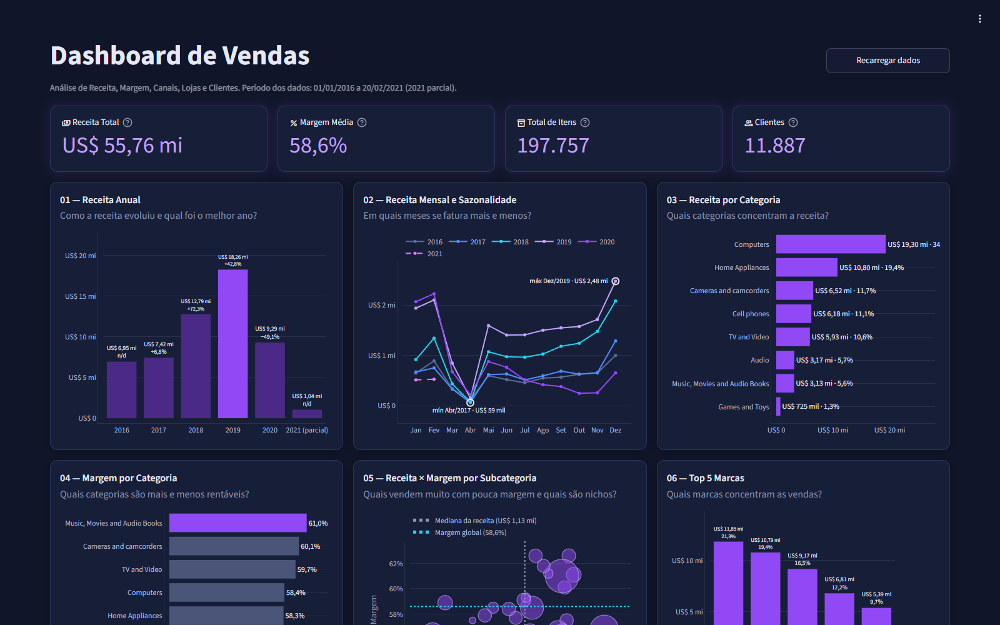
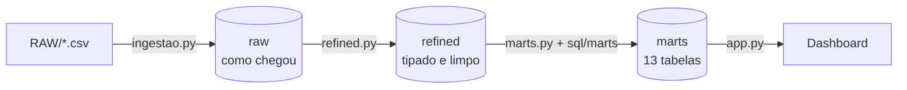

<div align="center">

# Varejo de Eletrônicos — Pipeline com DuckDB

**Das vendas brutas aos indicadores: ingestão em três camadas (raw → refined → marts) e um dashboard de vendas em Streamlit.**




</div>

**Navegação:** [Fonte dos dados](#1-fonte-dos-dados) · [As tabelas](#2-o-que-é-uma-linha-de-cada-tabela) · [Camadas e indicadores](#3-as-três-camadas-e-os-indicadores) · [Como rodar](#4-como-rodar-do-zero) · [Uso de IA](#5-uso-de-ia-neste-projeto)

> **Quem clona chega aos indicadores só com este README:** os CSVs já estão em [RAW/](RAW/) e o banco é gerado pelos comandos da [seção 4](#4-como-rodar-do-zero).

---

## 1. Fonte dos dados

| | |
|---|---|
| **Dataset** | *Global Electronics Retailers*: vendas de um varejista fictício de eletrônicos (transações, clientes, produtos, lojas e câmbio) |
| **Onde obter** | [Kaggle — Global Electronics Retailers](https://www.kaggle.com/datasets/bhavikjikadara/global-electronics-retailers), de Bhavik Jikadara (versão 1, maio de 2024) |
| **Licença** | **[CC BY 4.0](https://creativecommons.org/licenses/by/4.0/)** (Attribution 4.0 International): uso livre, **desde que o autor seja citado** |
| **Atribuição** | Dados: Bhavik Jikadara, *Global Electronics Retailers*, Kaggle, licença CC BY 4.0. Os CSVs de `RAW/` são cópias sem alteração; toda transformação acontece nas camadas seguintes |
| **Cópia no repositório** | Os seis CSVs originais em [RAW/](RAW/). Nenhum download é necessário |
| **Período** | 01/01/2016 a 20/02/2021. **2021 é parcial** (só janeiro e fevereiro) |

<details>
<summary>O mesmo dataset na Maven Analytics</summary>

O conjunto também aparece no [Data Playground da Maven Analytics](https://mavenanalytics.io/data-playground/global-electronics-retailer), que o rotula como *Public Domain*. Como a cópia do Kaggle é a que usamos e exige atribuição, este projeto segue o termo mais restritivo (CC BY 4.0).

</details>

## 2. O que é uma linha de cada tabela

| Tabela (raw → refined) | Uma linha é… | Linhas |
|---|---|---:|
| `sales` → `vendas` | **um item de um pedido** (produto, quantidade, cliente e loja) | 62.884 |
| `customers` → `clientes` | **um cliente**, com gênero, cidade, país e nascimento | 15.266 |
| `products` → `produtos` | **um produto**, com marca, categoria, custo e preço de lista em US$ | 2.517 |
| `stores` → `lojas` | **uma loja**, com país, estado, área em m² e abertura. A loja `0` é a **online** | 67 |
| `exchange_rates` → `taxas_cambio` | **uma moeda em um dia**, em unidades da moeda por 1 US$ | 11.215 |
| `data_dictionary` → `dicionario_dados` | **um campo** do dicionário original | 37 |

Total: **91.986 linhas**, iguais em `raw` e `refined`.

> **Atenção ao ler os números:** a tabela de vendas **não tem preço**. **Receita = quantidade × preço de lista atual do produto**, em US$, sem histórico de preços nem desconto. Moeda do pedido e câmbio não entram na receita.

## 3. As três camadas e os indicadores



Tudo fica em um único arquivo, `data/projeto.duckdb`, criado na execução (não é versionado).

| Camada | Script | O que faz |
|---|---|---|
| **raw** | [ingestao.py](ingestao.py) | Copia os 6 CSVs exatamente como chegaram, tudo como texto. Nada é convertido, descartado ou corrigido |
| **refined** | [refined.py](refined.py) | Lê só a raw. Nomes em português, tipos corretos e três correções (CEP, `?` em nomes, cidades em caixa alta). Nenhuma linha é descartada |
| **marts** | [marts.py](marts.py) | Executa cada arquivo de [sql/marts/](sql/marts/) e grava uma tabela `marts.<nome>`. A regra de negócio está nos `.sql` |

**Definições usadas em todos os indicadores**
- **Margem** é *ponderada*: lucro ÷ receita, nunca média de margens. Lucro = quantidade × (preço − custo), com preço e custo do cadastro atual.
- **Canal:** `chave_loja = 0` é a loja online; as demais são lojas físicas.
- **País** no mapa e no ranking é o do cliente.

<details>
<summary><b>Os 13 indicadores (marts)</b>: pergunta que cada um responde</summary>

<br>

Cada arquivo de `sql/marts/` abre com um cabeçalho dizendo a pergunta, o grão e as métricas.

| Mart | Pergunta que responde | Linhas |
|---|---|---:|
| `kpis` | Qual o tamanho do negócio? Receita, lucro, margem, itens, clientes e pedidos | 1 |
| `receita_anual` | Como a receita evoluiu por ano e qual foi o melhor? | 6 |
| `receita_mensal_sazonalidade` | Em quais meses se vende mais e menos? | 62 |
| `receita_por_categoria` | Quais categorias concentram a receita? | 8 |
| `margem_por_categoria` | Quais categorias são mais e menos rentáveis? | 8 |
| `receita_x_margem_subcategoria` | Quais subcategorias vendem muito com pouca margem? | 32 |
| `referencia_subcategorias` | Mediana de receita e margem global (linhas de referência) | 1 |
| `top5_marcas` | Quais marcas concentram as vendas? | 5 |
| `receita_por_pais` | Em quais países está a receita? | 8 |
| `online_x_lojas_fisicas` | Qual a fatia do online e ela cresce? | 14 |
| `desempenho_das_lojas` | Lojas maiores vendem mais? Quais são as mais produtivas por m²? | 57 |
| `tendencia_lojas` | Reta e R² de receita sobre m² | 1 |
| `perfil_de_clientes` | Faixa etária e gênero de quem compra e quanto gasta | 14 |

Total: 13 tabelas, 217 linhas.

</details>

<details>
<summary><b>Valores de referência</b>: para conferir a sua execução</summary>

<br>

| Indicador | Valor |
|---|---|
| Receita total | US$ 55.755.479,59 (US$ 55,76 mi) |
| Lucro | US$ 32.662.688,38 |
| Margem ponderada | 58,6% |
| Itens vendidos | 197.757 |
| Clientes distintos | 11.887 |
| Pedidos | 26.326 |
| Melhor ano | 2019 (US$ 18,26 mi) |
| Maior categoria | Computers (34,6%) |
| Maior país | Estados Unidos (53,6%) |
| Online × lojas físicas | 20,5% × 79,5% |

</details>

<details>
<summary><b>O dashboard</b>: o que mostra e como funciona</summary>

<br>

Uma página única, tema escuro, com 4 KPIs (receita, margem, itens, clientes) e 10 gráficos: receita anual, sazonalidade mensal, receita e margem por categoria, receita × margem por subcategoria, top 5 marcas, mapa por país, online × lojas físicas, desempenho das lojas e perfil de clientes.

O dashboard **não calcula nada**: lê as tabelas de `marts` em modo somente leitura. Um número novo na tela significa um `.sql` novo em `sql/marts/` e uma nova execução de `marts.py`. Não há filtros nem linha do tempo; os marts são agregados fixos.

</details>

## 4. Como rodar do zero

**Pré-requisitos:** [uv](https://docs.astral.sh/uv/) e Python 3.14 (o uv baixa o Python se faltar).

```bash
# 1. Clonar
git clone https://github.com/henneverton/varejo-eletronicos-pipeline-duckdb.git
cd varejo-eletronicos-pipeline-duckdb

# 2. Instalar dependências (cria o .venv; inclui pytest e ruff)
uv sync

# 3. Montar as três camadas, nesta ordem
uv run python ingestao.py     # raw      -> "Total: 91.986 registros"
uv run python refined.py      # refined  -> 91.986 registros, raw inalterada
uv run python marts.py        # marts    -> "13 marts, 217 linhas"

# 4. Abrir o dashboard (http://localhost:8501; Ctrl+C encerra)
uv run streamlit run app.py
```

Os três scripts podem ser repetidos sem medo: cada um recria o que é seu. Se faltar uma etapa, o script seguinte avisa qual comando rodar.

**Testes e lint**

```bash
uv run pytest        # 73 testes
uv run ruff check    # sem avisos
```

Os testes usam bancos temporários e nunca tocam o `data/projeto.duckdb` real.

<details>
<summary><b>Estrutura do repositório</b> e ferramenta opcional</summary>

<br>

```
RAW/            CSVs originais
ingestao.py     camada raw
refined.py      camada refined
marts.py        executa sql/marts/*.sql
sql/marts/      um .sql por indicador (a regra de negócio mora aqui)
painel.py       leitura dos marts, formatação e gráficos (sem Streamlit)
app.py          página do dashboard
ui.py           interface web do DuckDB (opcional)
tests/          testes das quatro etapas
docs/           imagem do dashboard
```

**Opcional:** `uv run python ui.py` abre a interface web do DuckDB (somente leitura) em `http://localhost:4213` para consultar as tabelas. Na primeira vez baixa uma extensão, então precisa de internet. O mapa do gráfico 07 também precisa de internet.

</details>

## 5. Uso de IA neste projeto

O projeto foi construído com o **Claude Code** (assistente de IA da Anthropic) trabalhando junto com o autor, em **desenvolvimento guiado por especificação**: a spec vem antes do código, e cada número foi conferido no banco, não de memória.

| Quem | Fez o quê |
|---|---|
| **IA** | Redigiu as specs, implementou scripts, `.sql` e testes a partir delas, e consultou o banco em modo somente leitura |
| **Autor** | Revisou, corrigiu e aprovou cada spec antes de qualquer código, e tomou as decisões de negócio |

<details>
<summary><b>Como o trabalho foi conduzido</b></summary>

<br>

1. **A spec vem antes do código.** Para cada etapa (ingestão, refined, marts, dashboard) a IA redigiu uma especificação com contexto, regras com o *motivo* de cada uma, números-base e critérios de aceite observáveis. O autor aprovou antes da implementação. As regras e motivos estão na docstring do topo de cada script.
2. **A IA implementou e testou.** Scripts, `.sql` e testes foram escritos a partir das specs aprovadas.
3. **Os números foram conferidos no banco.** A IA consultou os dados pelo servidor MCP do DuckDB, configurado em `.mcp.json` com `--readonly`, para fixar as contagens de referência e checar os critérios de aceite (por exemplo, a receita soma o mesmo valor em todos os marts que a trazem).
4. **As decisões de negócio são do autor:** tratar CEP, `?` em nomes e caixa alta de cidades; manter nulos e valores estranhos em vez de corrigir; margem ponderada; ordem do gráfico de margem; ficar sem filtros no dashboard.
5. **Revisão visual.** O dashboard foi revisado com capturas de tela de um Chrome headless; eixo de ano virando número, rótulos cortados e aba oculta com largura errada foram corrigidos.

</details>

<details>
<summary><b>Limites e erros encontrados</b></summary>

<br>

A IA pode errar, e já errou neste projeto: a primeira spec da refined dizia que não havia falhas de conversão de preço, mas 158 produtos tinham vírgula de milhar (`$2,899.99`). A conferência no banco pegou o erro antes de implementar, e a spec foi corrigida.

Por isso o projeto tem 73 testes automatizados e critérios de aceite verificados por consulta. Quem for reutilizar o código deve rodar os testes e conferir os valores de referência da seção 3.

As specs (`specs/`), o log de ações (`logs/`) e a skill de specs (`.claude/skills/spec/`) ficam fora do versionamento (`.gitignore`); o que aparece no repositório é o resultado delas.

</details>
